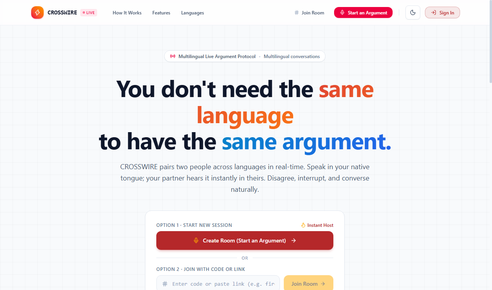
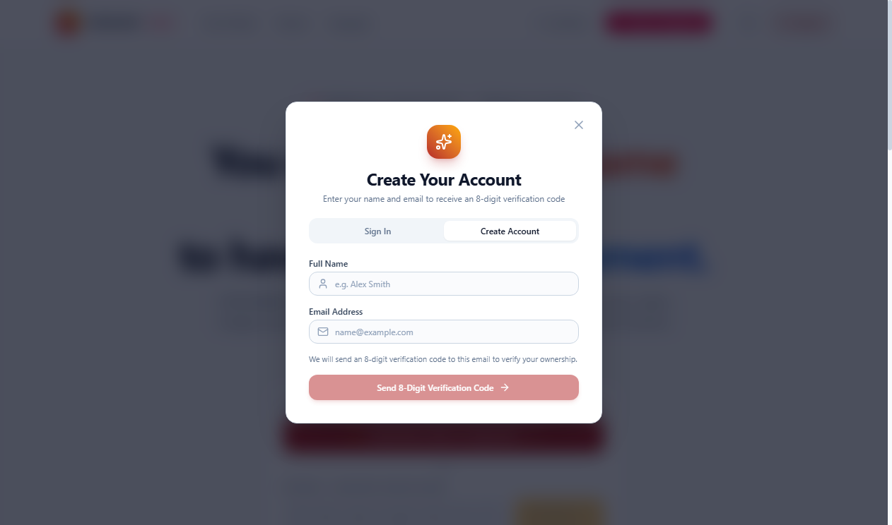
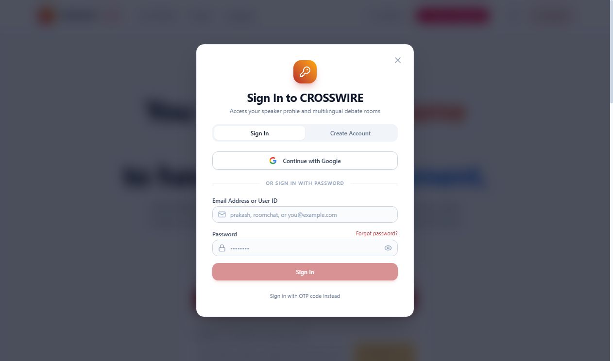
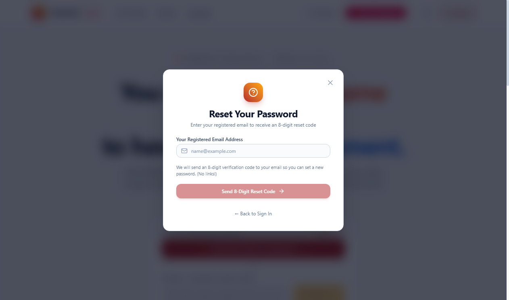
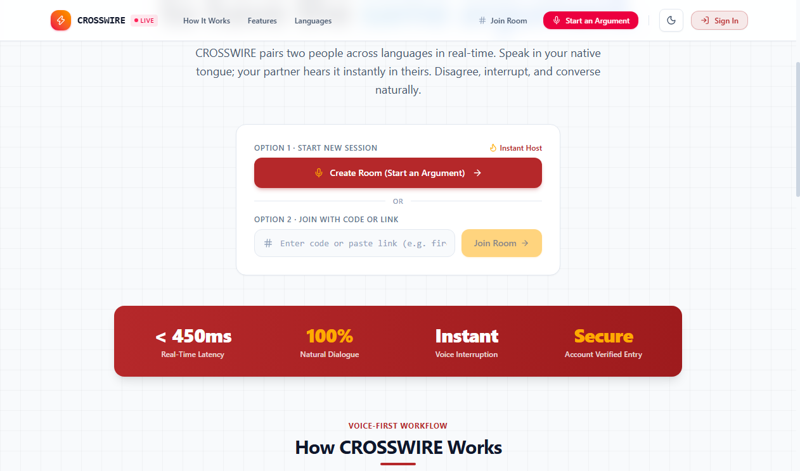
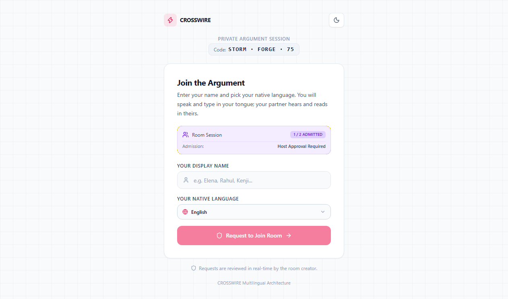
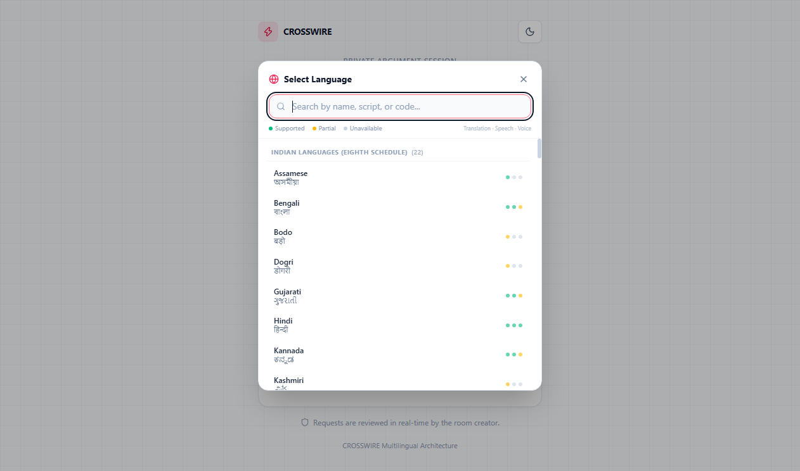
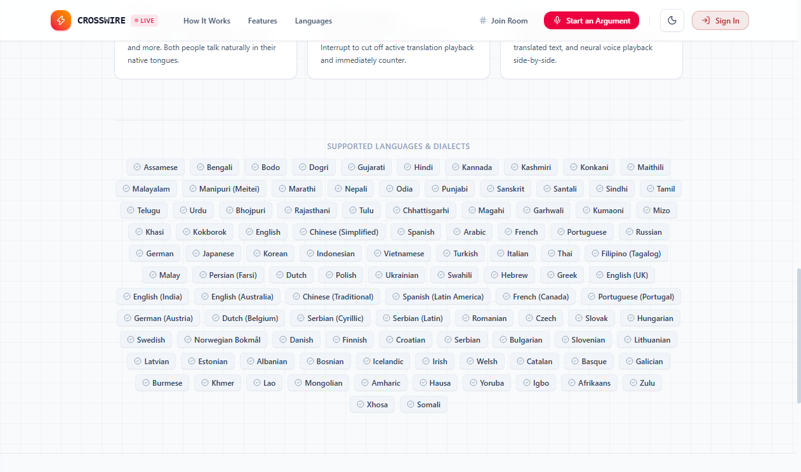

# CROSSWIRE

> **"You don't need the same language to have the same argument."**

[](https://room-chat-neon.vercel.app/)
[](https://nextjs.org/)
[](https://react.dev/)
[](https://www.typescriptlang.org/)
[](https://supabase.com/)

---

## Table of Contents

1. [Project Overview](#1-project-overview)
2. [Main Features](#2-main-features)
3. [How to Sign Up](#3-how-to-sign-up)
4. [How to Sign In](#4-how-to-sign-in)
5. [How to Reset a Forgotten Password](#5-how-to-reset-a-forgotten-password)
6. [How to Create a Room](#6-how-to-create-a-room)
7. [How to Join a Room](#7-how-to-join-a-room)
8. [How to Change Conversation Language](#8-how-to-change-conversation-language)
9. [How to Use Messaging and Voice](#9-how-to-use-messaging-and-voice)
10. [Host and Administrator Controls](#10-host-and-administrator-controls)
11. [Troubleshooting and Frequently Asked Questions](#11-troubleshooting-and-frequently-asked-questions)
12. [Developer Setup](#12-developer-setup)
13. [Project Links](#13-project-links)

---

## 1. Project Overview

**CROSSWIRE** is a real-time multilingual conversation and live debate platform engineered to eliminate language barriers. It allows participants who speak completely different languages to engage in natural, emotionally expressive dialogue.

Whether debating complex ideas, conducting cross-border collaboration, or holding 1-on-1 conversations, each person speaks or types in their native language while their partner hears and reads the message in theirs—with emotional nuance and cadence preserved.

Unlike standard static chat applications, CROSSWIRE features a **voice-first debate architecture** equipped with live browser speech recognition, automated bidirectional translation, natural speech synthesis, and real-time **voice interruption** that allows speakers to interject mid-sentence just like in a natural human debate.

- **Production Deployment:** [https://room-chat-neon.vercel.app/](https://room-chat-neon.vercel.app/)
- **Repository:** [https://github.com/om-prakash16/zero](https://github.com/om-prakash16/zero)


*Figure 1: CROSSWIRE Homepage featuring the Multilingual Live Argument Protocol hero and session entry points.*

---

## 2. Main Features

| Feature Area | Description | Status |
| :--- | :--- | :--- |
| **Secure Authentication** | Name and email registration, 8-digit verification code, and email/password sign-in. | **Verified** |
| **Password Recovery** | 8-digit verification code dispatched to email to securely authorize password resets. | **Verified** |
| **Google Authentication** | Optional OAuth sign-in (`Continue with Google`), configured via identity provider callback. | **Verified** |
| **Flexible Room Generation** | Memorable three-part room codes (e.g., `storm-forge-75`) and direct invitation URLs. | **Verified** |
| **Configurable Room Capacity** | Host-adjustable participant capacity from **2 (1-on-1 debate)** up to **16 participants**. | **Verified** |
| **Admission Modes** | Support for both **Host Approval Required** (moderated queue) and **Instant Auto-Approve**. | **Verified** |
| **Multilingual Registry** | Comprehensive language selection including global, European, Asian, and 22 Eighth Schedule Indian languages. | **Verified** |
| **Real-Time Translation** | Low-latency bidirectional server-side translation preserving tone, emotion, and context. | **Verified** |
| **Live Speech Recognition** | Hands-free microphone capture converting spoken audio to text in the user's native language. | **Verified** |
| **Speech Synthesis (TTS)** | Natural speech synthesis reading translated text aloud in the receiving partner's language. | **Verified** |
| **Instant Interruption** | Dedicated **Interrupt Partner** button that immediately halts active playback for natural back-and-forth debates. | **Verified** |
| **Audio Controls** | Per-user controls for **Voice: Auto / Voice: Manual** playback and instant **Mute** toggling. | **Verified** |
| **Host Controls** | Real-time join request approval/rejection modal, room capacity updates, and room closure. | **Verified** |
| **Data Protection & RLS** | Supabase PostgreSQL database protected by Row Level Security (RLS) policies. | **Verified** |

---

## 3. How to Sign Up

To create a new CROSSWIRE account:

1. **Navigate to the Application**: Open [https://room-chat-neon.vercel.app/](https://room-chat-neon.vercel.app/) in your browser.
2. **Open Registration**: Click **Sign In** in the navigation header, or click **Create Room (Start an Argument)**.
3. **Select Create Account Tab**: In the authentication modal, click the **Create Account** tab at the top.
4. **Enter Account Details**:
   - **Full Name**: Enter your display name (e.g., *Alex Smith*).
   - **Email Address**: Enter a valid email address where you can receive verification codes.
5. **Send Verification Code**: Click **Send 8-Digit Verification Code**. An 8-digit numeric verification code is dispatched to your email inbox.
6. **Verify Email**: Enter the 8-digit numeric code in the verification prompt.
7. **Set Password**: Enter your desired password (minimum 6 characters) and re-type it to confirm.
8. **Complete Registration**: Submit the form to finalize account setup. Your authenticated session is established immediately.


*Figure 2: CROSSWIRE Account Registration screen requesting Full Name and Email Address for verification.*

---

## 4. How to Sign In

Existing registered users can log in using either credentials or Google OAuth:

### Standard Sign-In
1. Open the application and click **Sign In** on the top-right navigation bar.
2. Ensure the **Sign In** tab is active.
3. Enter your registered **Email Address or User ID** in the first field.
4. Enter your account **Password** in the password field. You can click the eye icon to toggle password visibility.
5. Click the **Sign In** button. Upon authentication, you will be redirected to your active session.

### Alternative Sign-In Options
- **Continue with Google**: Click the **Continue with Google** button to authenticate with an authorized Google account. *(Note: Requires domain callback configuration in provider settings).*
- **Sign in with OTP code instead**: Click the text link at the bottom of the sign-in modal to request a one-time login code sent directly to your registered email.


*Figure 3: CROSSWIRE Sign In dialog supporting Email/Password, OTP sign-in, and Google authentication.*

---

## 5. How to Reset a Forgotten Password

If you lose or forget your account password:

1. Open the **Sign In** dialog.
2. Click the **Forgot password?** link located above the password field.
3. Enter your **Registered Email Address**.
4. Click **Send 8-Digit Reset Code**. The system dispatches a secure numeric authorization code to your inbox.
5. Enter the received 8-digit recovery code on the verification screen.
6. Once verified, the **Set New Password** interface will prompt you to enter and confirm your new password (minimum 6 characters).
7. Submit the form. Your password is updated in the database, previous access keys are invalidated, and you are logged in automatically.


*Figure 4: Password Recovery modal allowing users to request an 8-digit verification code.*

---

## 6. How to Create a Room

Only authenticated users can host and create rooms.

1. **Sign In**: Ensure you are signed in to your account.
2. **Initiate Room Creation**:
   - Click the primary **Create Room (Start an Argument)** button on the homepage hero, or
   - Click the **Start an Argument** button in the navigation bar.
3. **Configure Room Settings**:
   - **Your Display Name**: Enter the name you want debate partners to see.
   - **Your Preferred Language**: Select your native speaking and reading language using the dropdown.
   - **Room Capacity**: Select the maximum number of participants allowed simultaneously:
     - Default is **2 participants (1-on-1 debate)**.
     - Select **3, 4, 6, 8, 12, or 16** using the selector buttons or `+` / `-` controls for group discussions.
   - **Admission Mode**: Choose how new participants are admitted:
     - **Host Approval**: Guests must wait in a review queue until you approve their entry.
     - **Auto-Approve**: Guests join immediately as long as room capacity has not been reached.
4. **Copy Invitation Details**:
   - The modal displays an allocated unique room code (e.g., `storm-forge-75`).
   - Click **Change Code** if you want to generate an alternative code.
   - Click **Copy Link** to copy the full shareable invitation URL to your clipboard.
5. **Launch the Room**: Click **Create & Enter Room**. You will be redirected to `/room/[code]` as the host.

---

## 7. How to Join a Room

Participants can join an ongoing session using either the room code or an invitation link.

### Joining from the Homepage
1. On the CROSSWIRE homepage, navigate to **Option 2 · Join with Code or Link**.
2. Enter the room code (e.g., `storm-forge-75`) or paste the full invitation link.
3. Click **Join Room**.


*Figure 5: Homepage session hub showing Option 1 (Start New Session) and Option 2 (Join with Code or Link).*

### Joining via Direct Invitation Link
1. Click or open the invitation URL provided by the host (format: `https://room-chat-neon.vercel.app/room/<room-code>`).
2. The application validates the room code and opens the **Join the Argument** screen.
3. Review the room status badge:
   - Displays room occupancy (e.g., `1 / 2 Admitted`).
   - Displays admission mode (`Host Approval Required` or `Instant Auto-Admission`).
4. Enter your **Display Name**.
5. Select your **Native Language** from the language selector.
6. Submit your entry:
   - If **Auto-Approve** is enabled: Click **Join Room Now** to enter immediately.
   - If **Host Approval** is required: Click **Request to Join Room**. You will see a waiting screen while the host reviews your request.
7. **Capacity Reached Notice**: If the room has reached its maximum capacity, the interface displays: `"Room is full. Maximum participants allowed."`


*Figure 6: Real-time room admission screen showing session code, occupancy status, and admission mode.*

---

## 8. How to Change Conversation Language

CROSSWIRE allows each participant to choose their preferred language independently.

### During Room Creation or Joining
- Click the language selector on the setup screen to open the **Select Language** modal.
- Search by language name, native script, or language code (e.g., `Hindi`, `हिन्दी`, `hi`).
- Select your language from the categorized lists:
  - **Indian Languages (Eighth Schedule)**: Assamese, Bengali, Bodo, Dogri, Gujarati, Hindi, Kannada, Kashmiri, Konkani, Maithili, Malayalam, Manipuri, Marathi, Nepali, Odia, Punjabi, Sanskrit, Santali, Sindhi, Tamil, Telugu, Urdu.
  - **Global & Regional Languages**: English, Spanish, French, German, Japanese, Mandarin, Arabic, Portuguese, Russian, and more.


*Figure 7: Multilingual Selector featuring search, categorized groupings, and service capability indicators.*

### Understanding Capability Indicators
In the language selector, capability dots indicate feature availability:
- **Green Dot (`Supported`)**: Fully supported for real-time translation and voice services.
- **Yellow Dot (`Partial`)**: Supported for translation with partial or platform-dependent browser speech support.
- **Gray Dot (`Unavailable`)**: Text fallback mode.

### Changing Language Inside an Active Room
1. In the header bar of the active room, locate your personal language badge (e.g., `EN` with a globe icon).
2. Click your language badge to open the language switcher.
3. Select a new language.
4. **Behavior**:
   - Incoming messages from other participants will immediately begin translating into your new selected language.
   - Speech synthesis and microphone recognition will adjust to the new language.
   - Historical messages remain visible with their existing translations preserved.


*Figure 8: Supported Languages & Dialects registry dynamically rendered on the CROSSWIRE platform.*

---

## 9. How to Use Messaging and Voice

```
[Speaker A] ──(Native Speech)──> [Speech Recognition] ──> [Translation Service] ──> [Speech Synthesis] ──> [Speaker B]
     │                                                                                                           │
     └─────────────────────────────── <⚡ Interrupt Partner Button> ─────────────────────────────────────────────┘
```

CROSSWIRE is built for simultaneous, natural conversation without turn-taking bottlenecks.

### 1. Sending Text Messages
- Type your message into the text box at the bottom of the conversation panel.
- Press **Enter** or click the **Send** button.
- Both participants can type and send messages concurrently; the input is non-blocking.
- The message is sent to the server-side translation service, translated into the recipient's target language, and synchronized in real-time across sessions.

### 2. Live Microphone Voice Input
- Click the **Microphone** button on the left of the input panel.
- **Browser Permission**: If prompted, click **Allow** to grant microphone access.
- Speak naturally in your native language.
- A live transcript preview appears above the input bar in real time (e.g., *“We need to discuss this point...”*).
- Click the microphone button again (or finish speaking) to dispatch the message for translation.

### 3. Audio Playback (Speech Synthesis)
- When a new message arrives from your partner, CROSSWIRE synthesizes the translated text and reads it aloud in your native language.
- **Header Audio Controls**:
  - **Voice: Auto / Voice: Manual**: Toggle whether incoming translations speak automatically or require manual initiation.
  - **Mute / Unmuted**: Toggle the speaker icon in the room header to silence or enable all audio playback.

### 4. Real-Time Interruption ("Interrupt Partner")
- In high-energy debates, speakers frequently interject.
- If the application is currently reading a translated message aloud, the bottom bar highlights a prominent **⚡ Interrupt Translation (Cut In Now)** button.
- Clicking **Interrupt Partner**:
  - Immediately halts local audio playback mid-sentence.
  - Sends a cancellation signal via real-time synchronization to clear pending audio queues.
  - Allows you to immediately speak or type your counterargument without waiting.

---

## 10. Host and Administrator Controls

### Host Controls (Inside Room)

The room creator has exclusive access to moderation and configuration controls directly in the room header:

1. **Join Requests Management**:
   - When **Host Approval** mode is active, applicants appear in the host's review queue.
   - A pulsating **Requests** badge indicates pending applicants with a count badge (e.g., `Requests (1)`).
   - The host can click the badge to open the queue and select **Approve** or **Decline**.
2. **Room Settings Modal**:
   - The host can click **Settings** in the header to modify room capacity (from 2 up to 16) or switch between **Host Approval** and **Auto-Approve** modes during an active session.
3. **Session Termination**:
   - **Leave Room**: Allows the host to exit the session.
   - **End Room**: Closes the room permanently, terminating connections and notifying all connected participants.

### Administrative Oversight

CROSSWIRE includes a role-based access control (RBAC) architecture separating standard users from administrative operators:
- **Role Hierarchy**: System users are assigned roles (`user`, `admin`, `superadmin`).
- **Telemetry Monitoring**: Authorized administrative accounts can view real-time platform statistics, including active room counts, total registered users, overall message throughput, and language utilization.
- **Security Policy**: Administrative URLs, credentials, and sensitive audit records are restricted by server-side verification and are not publicly exposed.

---

## 11. Troubleshooting and Frequently Asked Questions

| Issue | Potential Cause | Verified Resolution |
| :--- | :--- | :--- |
| **Room Not Found** | Incorrect code entered or room has been closed by the host. | Check that the code matches the three-part format (e.g., `storm-forge-75`). Ensure no spaces or typos were added. |
| **Waiting on "Pending Approval"** | Room is configured in **Host Approval** mode. | The room creator must open their **Requests** modal and click **Approve** to admit you. |
| **"Room is Full" Message** | Maximum participant capacity has been reached. | The room has reached its configured limit (default 2). The host must increase capacity in room settings or participants must leave. |
| **Microphone Not Working** | Browser denied microphone permission. | Click the lock/settings icon in your browser address bar, set **Microphone** to **Allow**, and refresh the page. |
| **Speech Recognition Unavailable** | Browser does not support Web Speech API. | Desktop Chrome and Edge offer full native recognition. In browsers without speech support (e.g., Firefox), use the text input box. |
| **No Audio Playback Heard** | Audio is muted or browser autoplay policy blocked sound. | Ensure the **Mute** icon in the room header is unmuted and **Voice: Auto** is active. Click anywhere on the page to satisfy browser user-gesture requirements. |
| **Verification Code Not Received** | Code sent to spam folder or email address mistyped. | Check your spam/junk folder. Click **Resend Code** after the 45-second countdown expires. |
| **Google Sign-In Redirect Issue** | Authorized redirect URI mismatch. | Ensure the deployment domain (e.g., `https://room-chat-neon.vercel.app/auth/callback`) is added to the authentication provider's allowed callback list. |

---

## 12. Developer Setup

### Prerequisites

- **Node.js**: `v18.0.0` or later (tested on Node `v20` and `v22`).
- **Package Manager**: `npm` `9+`.
- **Database Backend**: A [Supabase](https://supabase.com) project with PostgreSQL and Realtime enabled.

### 1. Clone the Repository

```bash
git clone https://github.com/om-prakash16/zero.git
cd zero
npm install
```

### 2. Configure Environment Variables

Create a `.env.local` file in the root directory:

```bash
cp .env.example .env.local
```

Configure the following environment parameters:

```env
# Public Supabase Connection
NEXT_PUBLIC_SUPABASE_URL=https://your-project-id.supabase.co
NEXT_PUBLIC_SUPABASE_ANON_KEY=your-supabase-anon-key

# Server-Side Translation Service
# Provide your translation service API credentials here (kept private, server-side only)
TRANSLATION_SERVICE_KEY=your-server-side-api-key
```

> **Security Note:** Server-side API credentials must never be exposed to the browser or committed to public version control.

### 3. Database Schema Setup

1. Open your Supabase Project dashboard.
2. Navigate to the **SQL Editor**.
3. Run the schema migrations located in `supabase/migrations/001_initial_schema.sql`.
4. Ensure the `supabase_realtime` publication includes:
   - `rooms`
   - `participants`
   - `messages`
   - `join_requests`

### 4. Available Package Scripts

Inspected and verified from `package.json`:

| Command | Action |
| :--- | :--- |
| `npm run dev` | Starts the Next.js development server at `http://localhost:3000`. |
| `npm run build` | Compiles the production build with Turbopack SSR optimization. |
| `npm run start` | Starts the compiled production server. |
| `npm run lint` | Runs ESLint checks across all project files. |
| `npm test` | Executes the complete automated test suite (`tsx lib/__tests__/runAllTests.ts`). |

---

## 13. Project Links

- **Live Production Application:** [https://room-chat-neon.vercel.app/](https://room-chat-neon.vercel.app/)
- **Source Code Repository:** [https://github.com/om-prakash16/zero](https://github.com/om-prakash16/zero)
- **Deployment Platform:** Vercel (Edge & Serverless Runtime)
- **Database & Realtime Provider:** Supabase PostgreSQL

---

*CROSSWIRE — Multilingual Live Argument Protocol.*
