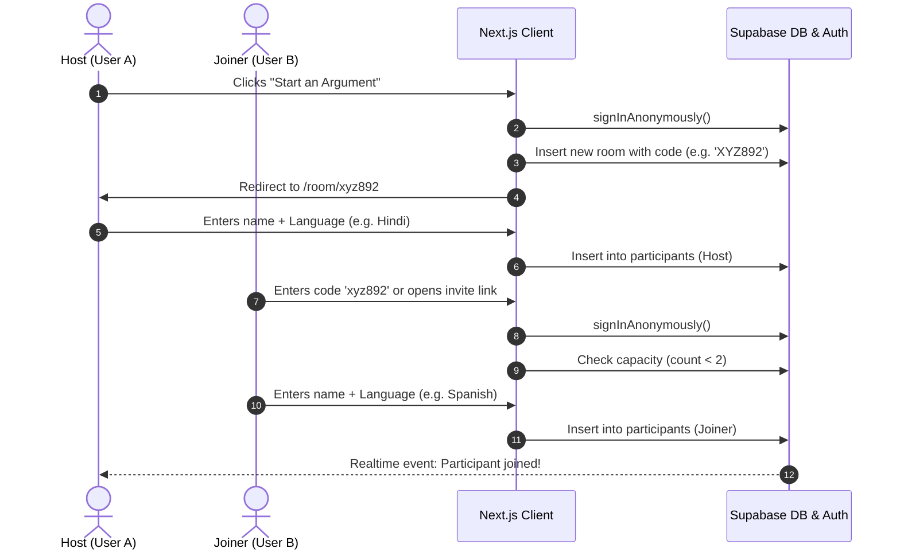
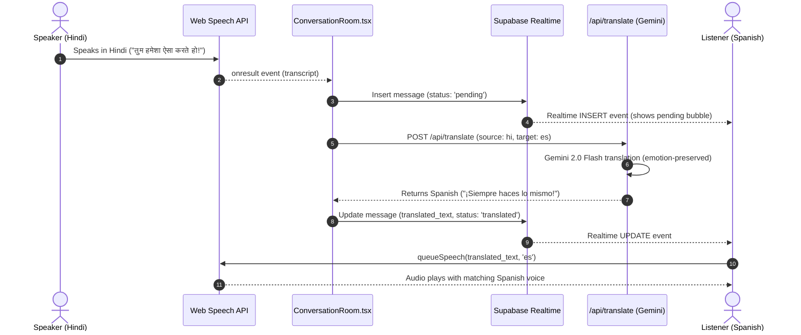
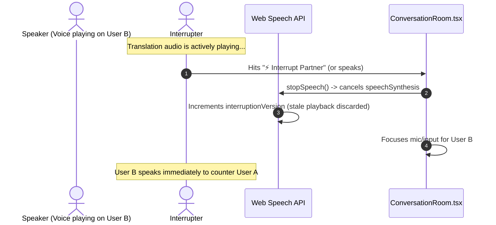

# CROSSWIRE — Central Architecture & Engineering Memory (brain.md)
*Last Updated: 2026-10-17 | Maintained for immediate context recovery & daily development*

---

## 1. Executive Summary & Product Vision

**CROSSWIRE** is a real-time, voice-first multilingual argument platform designed to enable two people who speak completely different languages to engage in a fast, natural, and emotionally expressive argument.

> *"You don't need the same language to have the same argument."*

### Core Philosophy
1. **Unsanitized Emotional Nuance**: Unlike sterile corporate translation tools, CROSSWIRE does not tone down anger, frustration, sarcasm, or profanity. If speaker A says something biting in Hindi, speaker B hears the exact equivalent biting tone in Spanish.
2. **Instant Interruption**: Natural arguments don't wait for polite turn-taking. If one participant is speaking and the other hits "Interrupt", the playback halts instantly and the interrupter takes the floor.
3. **Dual-Channel Feedback**: Both participants see and hear the dialogue in real time—with original speech transcribed and translated speech displayed and voiced simultaneously.
4. **Minimalist, Standardized 2-Theme Design**: A clean, accessible SaaS design adhering to strict 4px/8px spacing grids, standard 48px touch targets, and instant 1-click toggling between **Light Mode** (default crisp minimal slate) and **Dark Mode** (obsidian).

---

## 2. Technical Stack

| Layer | Technology | Version | Purpose |
| :--- | :--- | :--- | :--- |
| **Framework** | Next.js (App Router + Turbopack) | `16.4.2` | React 19 server/client components, API routes |
| **Language** | TypeScript | `^5` | Strict type checking throughout |
| **Styling** | Tailwind CSS v4 + Vanilla CSS Variables | `^4.3.3` | Modern CSS-first config with `@custom-variant dark` |
| **Icons** | Lucide React | `^1.59.0` | Minimal SVG iconography |
| **Database & Realtime** | Supabase (PostgreSQL + Realtime Channels) | `@supabase/supabase-js ^2.118` | Anonymous auth, postgres changes CDC |
| **Translation Engine** | Google Gemini 3.8 Flash | `@google/genai ^2.30.0` | Emotion-preserving translation via serverless route |
| **Voice / Speech** | Web Speech API | Native Browser | `SpeechRecognition` (STT) + `SpeechSynthesis` (TTS) |
| **State / Theme** | React 19 Context + localStorage | Native | Dual-theme state with anti-flash synchronization |

---

## 3. Directory & File Inventory

```
e:\Project\zero\
├── app\
│   ├── api\
│   │   └── translate\
│   │       └── route.ts              # Gemini 2.0 Flash translation API endpoint
│   ├── room\
│   │   └── [code]\
│   │       └── page.tsx              # Dynamic room page with Suspense boundary
│   ├── favicon.ico                   # App icon
│   ├── globals.css                   # Tailwind v4 imports, dual-theme tokens & animations
│   ├── layout.tsx                    # Root layout with ThemeProvider & metadata
│   └── page.tsx                      # Minimalist dual-theme landing page
├── components\
│   ├── ConversationRoom.tsx          # Real-time room controller & Supabase Realtime channel
│   ├── JoinRoomModal.tsx             # 2-person join modal (name & native language picker)
│   ├── MessageList.tsx               # Minimalist chat bubbles, translations, playback waveform
│   ├── RoomHeader.tsx                # Status indicator, participant chips, copy invite link, ThemeToggle
│   ├── SpeakingPanel.tsx             # Microphone toggle, text input, language guide, Interrupt button
│   ├── ThemeProvider.tsx             # ThemeContext providing 'light' | 'dark' & toggleTheme()
│   └── ThemeToggle.tsx               # Accessible Sun/Moon toggle button
├── lib\
│   ├── __tests__\
│   │   └── roomCode.test.ts          # Unit tests for room code generation & normalization
│   ├── roomCode.ts                   # 6-character unambiguous room code generator
│   ├── speech.ts                     # Web Speech API wrapper with interruptionVersion queue
│   ├── supabase.ts                   # Supabase client with graceful development fallback
│   └── types.ts                      # Core TypeScript definitions (Room, Participant, Message, etc.)
├── public\                           # Static assets
├── supabase\
│   └── migrations\
│       ├── 001_initial_schema.sql    # Complete SQL migration with RLS, triggers & Realtime
│       └── 002_messages_update_policy.sql # Secure messages UPDATE policy, column immutability trigger & grants
├── .env.example                      # Template environment variables
├── .env.local                        # Local development environment keys
├── brain.md                          # THIS FILE (Engineering memory & roadmap)
├── next.config.ts                    # Next.js configuration
├── package.json                      # Project dependencies & scripts
├── PROJECT_AUDIT_REPORT.md           # Complete audit report with verification metrics
├── README.md                         # Product documentation & setup instructions
└── tsconfig.json                     # TypeScript strict configuration
```

---

## 4. Database Schema & Realtime Specifications

Location: [supabase/migrations/001_initial_schema.sql](file:///e:/Project/zero/supabase/migrations/001_initial_schema.sql)

### Tables
1. **`rooms`**:
   * `id` (UUID PK): Unique room identifier
   * `code` (TEXT UNIQUE): 6-character room code (e.g. `ABC-123`)
   * `is_active` (BOOLEAN): Defaults to `TRUE`
   * `participant_count` (INTEGER): Automatically managed by DB triggers (`update_room_participant_count`)
   * `created_at`, `updated_at` (TIMESTAMPTZ)

2. **`participants`**:
   * `id` (UUID PK)
   * `room_id` (UUID FK -> `rooms.id`)
   * `user_id` (UUID): Supabase anonymous auth user ID
   * `display_name` (TEXT)
   * `language_code` (TEXT): e.g. `'hi'`, `'es'`, `'en'`, `'fr'`
   * `language_name` (TEXT): e.g. `'Hindi'`, `'Spanish'`
   * `is_connected` (BOOLEAN)
   * `joined_at`, `last_seen_at` (TIMESTAMPTZ)
   * *Constraint*: Enforces max 2 participants via `check_room_capacity()` trigger.

3. **`messages`**:
   * `id` (UUID PK)
   * `room_id` (UUID FK -> `rooms.id`)
   * `sender_id` (UUID): User who spoke/typed
   * `sender_name` (TEXT)
   * `original_text` (TEXT): Spoken or typed in native tongue
   * `translated_text` (TEXT, nullable): Translated via Gemini
   * `source_language` (TEXT)
   * `target_language` (TEXT)
   * `translation_status` (TEXT): `'pending'` | `'translated'` | `'failed'`
   * `created_at` (TIMESTAMPTZ)

### Realtime Publication
Tables published to `supabase_realtime`:
```sql
ALTER PUBLICATION supabase_realtime ADD TABLE public.rooms;
ALTER PUBLICATION supabase_realtime ADD TABLE public.participants;
ALTER PUBLICATION supabase_realtime ADD TABLE public.messages;
```

---

## 5. Core Architectural Flows

### A. Room Creation & Joining Flow


### B. Speech, Translation & Audio Playback Flow


### C. The Interruption Protocol


---

## 6. Dual-Theme Architecture & Standards

### Implementation Overview
* Configured in [app/globals.css](file:///e:/Project/zero/app/globals.css) using Tailwind v4 directive:
  `@custom-variant dark (&:where(.dark, .dark *));`
* Managed by [components/ThemeProvider.tsx](file:///e:/Project/zero/components/ThemeProvider.tsx) and toggled via [components/ThemeToggle.tsx](file:///e:/Project/zero/components/ThemeToggle.tsx).

### Theme Tokens Matrix

| Property | Light Theme (Default Standard) | Dark Theme |
| :--- | :--- | :--- |
| **Canvas Background** | `#f8fafc` (slate-50) | `#09090b` (zinc-950) |
| **Cards & Surfaces** | `#ffffff` (pure white, shadow-xs) | `#121215` (obsidian zinc) |
| **Borders** | `#e2e8f0` (slate-200) | `#27272a` (zinc-800) |
| **Primary Typography** | `#0f172a` (slate-900) | `#f8fafc` (zinc-100) |
| **Secondary Typography**| `#475569` (slate-600) | `#94a3b8` (zinc-400) |
| **Participant A Accent** | Crimson `#e04434` / `bg-rose-50 border-rose-200` | Coral `#f87171` / `bg-rose-950/20 border-rose-900/40` |
| **Participant B Accent** | Azure `#0284c7` / `bg-sky-50 border-sky-200` | Sky `#38bdf8` / `bg-sky-950/20 border-sky-900/40` |
| **Active Mic Pulse** | Crimson `#e04434` with 10px pulse ring | Crimson `#e04434` with 10px pulse ring |

---

## 7. Supported Languages Directory

Defined in [lib/types.ts](file:///e:/Project/zero/lib/types.ts):

| Code | Language | Native Name | Speech Code |
| :--- | :--- | :--- | :--- |
| `en` | English | English | `en-US` |
| `es` | Spanish | Español | `es-ES` |
| `hi` | Hindi | हिन्दी | `hi-IN` |
| `fr` | French | Français | `fr-FR` |
| `de` | German | Deutsch | `de-DE` |
| `zh` | Mandarin | 中文 | `zh-CN` |
| `ja` | Japanese | 日本語 | `ja-JP` |
| `ar` | Arabic | العربية | `ar-SA` |
| `pt` | Portuguese | Português | `pt-PT` |
| `ru` | Russian | Русский | `ru-RU` |
| `it` | Italian | Italiano | `it-IT` |
| `ko` | Korean | 한국어 | `ko-KR` |

---

## 8. Environment Setup & Configuration

File: [e:\Project\zero\.env.local](file:///e:/Project/zero/.env.local)

```env
# 1. Supabase credentials (https://supabase.com/dashboard > Project Settings > API)
NEXT_PUBLIC_SUPABASE_URL=https://your-project-id.supabase.co
NEXT_PUBLIC_SUPABASE_ANON_KEY=eyJhbGciOi...

# 2. Google Gemini API Key (https://aistudio.google.com/app/apikey)
GEMINI_API_KEY=AIzaSy...
```

*Note: In local development without Supabase credentials, the app gracefully runs with placeholder values and shows a setup banner on the landing page.*

---

## 9. Current Verification Status

- [x] **TypeScript Strict Check**: `npx tsc --noEmit` exits with `0` errors.
- [x] **ESLint Static Analysis**: `npm run lint` exits with `0` errors and `0` warnings.
- [x] **Automated Test Suite**: `npm test` runs 33 assertions with `100%` pass rate.
- [x] **Production Build**: `npm run build` compiles in ~1s and generates all 4 routes.
- [x] **Unit Testing**: Room code generation & normalization verified via `lib/__tests__/fullAudit.test.ts`.
- [x] **Audit Report**: Documented in `PROJECT_AUDIT_REPORT.md`.

---

## 10. Tomorrow's Development Roadmap & Next Steps

When resuming work tomorrow, prioritize the following tasks in order:

### Priority 1: Supabase Production Deployment & Live Pair Testing
- [ ] Connect live Supabase project by applying [supabase/migrations/001_initial_schema.sql](file:///e:/Project/zero/supabase/migrations/001_initial_schema.sql) in Supabase SQL Editor.
- [ ] Add real `NEXT_PUBLIC_SUPABASE_URL` and `NEXT_PUBLIC_SUPABASE_ANON_KEY` to `.env.local`.
- [ ] Perform live two-browser cross-device argument session (Hindi <-> Spanish) to verify real-time voice latency.

### Priority 2: Audio & Voice Enhancements
- [ ] **Voice Activity Detection (VAD)**: Add auto-send when silence is detected for > 1.2s so the user doesn't have to manually press stop.
- [ ] **Cloud TTS Fallback**: Integrate Edge TTS or Gemini Audio output for mobile browsers / Linux environments where native Web Speech API synthesis voices are limited.
- [ ] **Emotional Intensity Meter**: Add a live visual frequency wave or argument intensity meter that dynamically reacts to voice volume and exclamation marks.

### Priority 3: Argument Utilities & Post-Conversation Features
- [ ] **Debate Verdict / Recap**: Add a "Wrap Up Argument" button that calls Gemini to produce an impartial summary of both sides' points, who argued which perspective, and key agreements/disagreements.
- [ ] **Audio Export / Transcript Download**: Allow participants to download a clean bilingual PDF or Markdown transcript of their conversation.

---

## 11. Quick Start Guide for Tomorrow

```bash
# 1. Navigate to project root
cd e:\Project\zero

# 2. Check TypeScript status
npx tsc --noEmit

# 3. Start local development server (if not already running)
npm run dev

# 4. Open in browser
# http://localhost:3000
```
